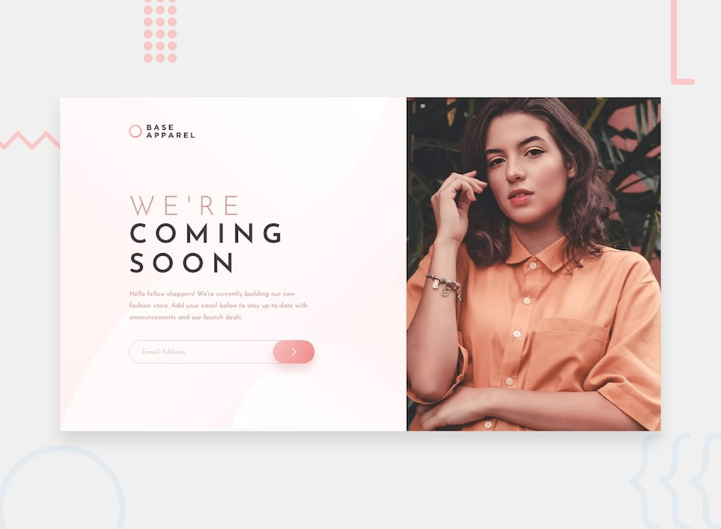

# Base Apparel coming soon page| Frontend Mentor Challenge

This challenge is part of my journey to master responsive design with HTML, CSS & JavaScript

## Live Preview
https://jmg002050.github.io/Base-Apparel/

## 📸 Preview

## Features

* Responsive layout for mobile, desktop and mid-size screens
* Animated buttons
* Responsive actions using Vanilla Javascript

## Built With

* HTML5
* CSS3
* JavaScript

## What I Learned

While building this project, I practiced:

* Structuring HTML for maintainability and readability
* Starting the layout with a mobile-first approach, using percentages rather than fixed values (px), and defining the required containers to organize the content along with clamp and min widths
* Positioning elements relative to one another
* Made sure to follow the original design as close as possible
* Made sure to select the right elements using JS to ensure smooth and easy interaction
* Made sure that the user could navigate the UI accordingly, intuitive design 

## Challenges
* HTML semantics still need more improvement - repetition, especially to facilitate the use of CSS
* Moving from mobile design to desktop design as the flow of the element changes, but grid allowed for more control
* CSS - a few properties still new and hard for me to put in practice but I just need more repetition
* JS - there is almost something new with JS and how to achieve a certain reaction, still need more practice 

## Future Improvements

* Expanding the site with more elements

## Acknowledgements

Challenge provided by Frontend Mentor, Conquering Responsive Design.

## Author

Jorge Martinez

* [GitHub: https://github.com/yourusername](https://github.com/JMG002050)
* https://www.frontendmentor.io/
